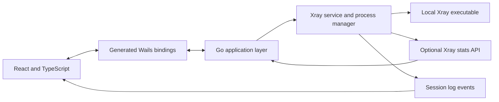

# ZirGozar

ZirGozar is a desktop application for running the [Xray-core](https://github.com/XTLS/Xray-core) engine with locally managed server profiles. Import a supported share link, subscription list, or Xray JSON file, choose a connection mode, and control the local Xray process from one small interface.

ZirGozar is a client, not a proxy service: you need to supply a server configuration or endpoint.

## Screenshots

There are no verified screenshots of the current application in the repository yet. Add screenshots of a running desktop build here when available; no mockups are presented as product captures.

## Features

### Connection

- Start and stop one managed Xray process; the UI polls the Go backend for process state.
- Choose local proxy, LAN-share, or TUN mode for URI-generated profiles.
- Check a selected URI server with a TCP reachability probe. This is not a full protocol handshake or an end-to-end VPN test.
- Switch a selected URI profile while connected by stopping the current process before starting the new one.
- Import local Xray JSON files and validate them with the bundled Xray core before saving and again before launch.

### Profiles

- Save and rename profiles with one or more supported `vless://`, `vmess://`, `trojan://`, or `ss://` links.
- Import subscription URLs that return supported links as text or a Base64-encoded list.
- Keep profile names, share URIs, and the selected local JSON path in the desktop webview's local storage.
- Delete profiles with confirmation.

### Runtime and diagnostics

- View the backend-confirmed Xray process state.
- Show live upload/download rates and cumulative counters for URI-generated configurations when Xray's stats API is available. Imported JSON files are run as supplied, so stats may not be available for them.
- View recent Xray process output captured for the current app session; clear or export the in-memory entries.
- See a clear unavailable state when traffic stats are not exposed by the active configuration.

### Desktop

- Built with Go, Wails, React, and TypeScript.
- Extracts the embedded Xray executable to the operating system's user cache.
- Includes a Linux desktop-entry installer script.

## Platform support

The checked-in Xray runtime asset is for **Linux amd64**. The build workflow also has Linux and macOS jobs; `scripts/download-xray.sh` fetches the matching Xray release asset for supported Linux amd64/arm64 and macOS amd64/arm64 build hosts. These downloads are build-time steps.

Windows is not currently covered by the repository's asset-download script or CI build workflow. Although parts of the Go runtime recognize Windows targets, ZirGozar does not claim a supported Windows distribution yet. Linux desktop builds require GTK 3 and WebKit2GTK 4.1 development libraries.

## Installation

There are no published release download links in this repository. Build from source using the steps below. On Linux, the generated binary is placed in `build/bin/zirgozar`.

To add a launcher for the current Linux user after building:

```bash
./scripts/install-linux-desktop.sh
```

## Quick start

1. Launch ZirGozar from a built desktop binary or run `wails dev` from the repository root.
2. Open **Profiles** and add a supported share URI, fetch a subscription containing supported URIs, or import a local Xray JSON configuration.
3. Give the profile a recognizable name and save it. A URI profile can contain multiple server links.
4. Choose **Local proxy**, **LAN share**, or **TUN** in **Settings**. Local proxy mode creates a listener; it does not automatically configure other applications to use it.
5. On **Home**, select a server if the profile contains multiple links, then choose **Connect**.
6. Confirm the status says **Connected**. This indicates that the Xray process is running; it does not prove that the remote endpoint is reachable or that system-wide traffic is routed through it.
7. Review **Logs** if startup fails. Choose **Disconnect** to stop the process.

The application does not create server access credentials or provide a remote endpoint. TUN mode can require platform-specific permissions. LAN mode exposes an unauthenticated SOCKS5 listener on the selected private interface; use it only on a trusted network.

## Development setup

### Requirements

- Go 1.25 or newer (the module declares Go 1.25)
- Node.js 22 and npm
- Wails CLI v2.16.0
- Linux desktop build dependencies, when building on Linux: `build-essential`, `pkg-config`, `libgtk-3-dev`, and `libwebkit2gtk-4.1-dev`
- A network connection during setup if the matching Xray release asset is not already present

Install Wails:

```bash
go install github.com/wailsapp/wails/v2/cmd/wails@v2.16.0
```

Install frontend dependencies, prepare the host Xray asset if needed, and build:

```bash
cd frontend
npm ci
cd ..
bash scripts/download-xray.sh
wails generate module
cd frontend
npm run build
cd ..
wails build -tags webkit2_41
```

On macOS, use `wails build` without the Linux-specific tag. `scripts/download-xray.sh` selects the Xray asset based on the host OS and architecture.

For development, make sure the matching Xray asset exists and the frontend dependencies are installed, then run:

```bash
wails dev
```

Checks:

```bash
cd frontend && npm run typecheck
cd ..
go test ./...
go vet ./...
```

The frontend production build (`npm run build`) runs TypeScript checking before Vite. After changing exported Go methods, run `wails generate module` so the frontend bindings match the backend.

## Architecture



The frontend is a Wails webview. `app.go` exposes the application API, while `internal/xray/` validates share URIs and JSON files, prepares temporary URI-generated configurations, manages the Xray child process, and queries optional traffic counters. Wails embeds the production frontend from `frontend/dist`.

## Profiles and local data

- Supported URI schemes are `vless://`, `vmess://`, `trojan://`, and `ss://`. Xray JSON files are validated by running the selected Xray core in test mode.
- Subscription support is limited to HTTP(S) responses containing those links as plain text or a Base64-encoded text list. This is not a general subscription-provider or arbitrary Xray format implementation.
- Profiles and connection preferences are stored in webview local storage. URI profiles include credentials in their share links, so this data is local but **not encrypted by ZirGozar**.
- Imported JSON profile records retain the selected file path; the source file is not copied or modified. Keep that file available and protect it as you would any credential-bearing configuration.
- URI-generated runtime configuration is written with restrictive permissions into a temporary directory under the OS cache and removed when the Xray process stops. Imported JSON is passed to Xray at its selected path.
- Recent process logs are held in memory for the current app session. Review exported logs before sharing them.

## Troubleshooting

| Symptom | What to check |
|---|---|
| Xray executable not found | Ensure an asset for the current platform/architecture was embedded. Run `bash scripts/download-xray.sh` on a supported build host, then rebuild. |
| JSON import rejected | The file must be a valid Xray JSON object accepted by the bundled core. Check syntax and compatibility with the included Xray version. |
| Connection starts but the endpoint is unreachable | **Connected** means the local Xray process is running. Check the endpoint, credentials, DNS, firewall, and recent output on the Logs page. The server test only measures TCP reachability. |
| No traffic counters | Stats are available only when the running config exposes Xray's stats API. Imported JSON configurations may not have the instrumentation enabled. |
| TUN startup fails | TUN interfaces and routing can require administrator permissions and platform-specific setup. Use Logs to inspect Xray output. |
| Frontend/backend calls fail | Re-run `wails generate module`, then build the frontend and desktop app again. |
| Linux desktop build fails | Install the GTK 3 and WebKit2GTK 4.1 development packages listed above, then retry. |

## Security and privacy

ZirGozar starts the Xray executable locally. It does not encrypt profile data in local storage, and share URIs/configuration files may contain credentials or keys. Do not expose them in screenshots, exported logs, or support requests. The LAN-share mode does not add authentication; only use it on a trusted private network and do not forward its port from a router.

## Known limitations and roadmap

Implemented behavior and current limitations are recorded in [the roadmap](./docs/roadmap.md). In particular, Windows packaging, published releases, persistent log files, subscription auto-refresh, and platform-specific TUN setup are not currently provided.

## Contributing

Read [the development guide](./docs/development.md), make changes that preserve the Go/Wails architecture, and run the frontend build, Go tests, and `go vet` before submitting a change. Update the README when user-visible behavior or supported platforms change.

## License and acknowledgments

ZirGozar is distributed under the [MIT License](./LICENSE). It uses [Xray-core](https://github.com/XTLS/Xray-core), [Wails](https://wails.io/), [React](https://react.dev/), and [Vite](https://vite.dev/). The bundled Xray asset includes its own license and notices under `internal/xray/assets/`.
